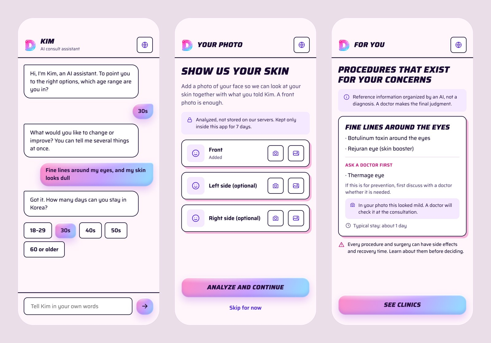
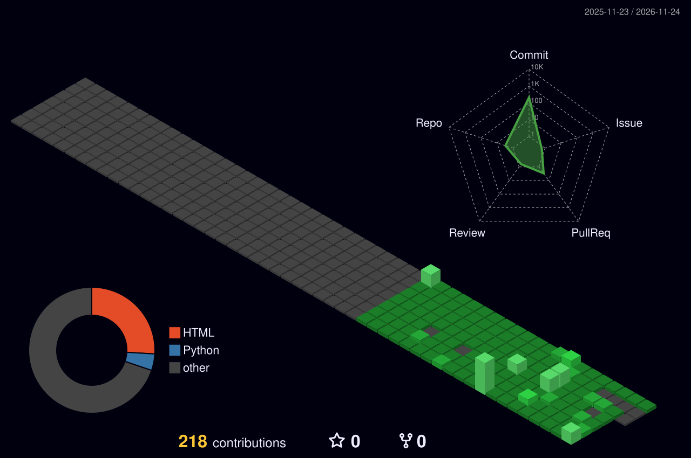

 

  

---

## About Me

I have spent **11 years exporting Korean sports content to 29 markets on five continents**, working across product planning, production, contracts and sales for a business that grew past ₩100B in annual revenue. Since 2024 I have handled contract and rights work with partner institutions in the US, France, the UK, Australia, Singapore and Hong Kong, and in 2026 I was chief director of the first official Korea Cup press conference.

I am completing an **M.S. in Artificial Intelligence at Yonsei University** (expected December 2026), focused on LLMOps, vision-language models and applied AI, and I build the products below myself.

**Portfolio:** [jokim90.github.io](https://jokim90.github.io) (English / Korean) · **Email:** jokim90@gmail.com · **Languages:** Korean · English · French

---

## Featured Projects

### Korean Doctors · AI consult assistant for visitors to Korea

A mobile app that helps international visitors see which aesthetic procedures exist for their concerns before they travel.

- **Kim**, an AI consult assistant, leads a free-form conversation in English, Arabic or Korean
- A photo analysis step adds context, and a rule engine organises the relevant procedure information
- Kim informs and never decides: a doctor makes the final judgment in person
- Photos are analysed without being stored on a server and go only to the clinic the user picks

**Role:** product concept, UX and brand design, AI agent design · **Status:** in development, 2027

### Jeju Racing · real-time English form guide

A site that collects race data from Korea Racing Authority public data and uses AI to generate English commentary and form guides for Jeju horse racing. Planned and built end to end, from data sourcing to the prototype and vendor procurement.

[Live prototype](https://krainternational.github.io/jeju-racecard/)

### Ryoony · AI interview agent

An LLM agent that answers interview questions only from my own career records, shows the source cards behind each answer, and forwards anything it cannot answer to me by email. Korean and English.

[Try it on the portfolio](https://jokim90.github.io/#ryoony)

---

## Core Expertise

---

## Portfolio Areas

| Area | Description |
|---|---|
| **[01. Global Broadcast Production](./global-broadcast-production)** | End-to-end broadcast production, live production, audio recording, video editing, broadcast delivery, and production QA |
| **[02. International Content Portfolio](./international-content-portfolio)** | Korea Cup promotion, France Galop, World Horse Racing, Racing & Sports, Arirang TV, and international media relations |
| **[03. Editorial Excellence & Language QA](./editorial-language-qa)** | English editorial writing, broadcast scripts, press releases, translation review, terminology consistency, fact verification, and publication approval |
| **[04. Localization & Global Communication](./localization-global-communication)** | Cross-cultural communication, localization decisions, English-Korean adaptation, and global stakeholder coordination |
| **[05. Process Innovation](./process-innovation)** | Workflow optimization, production documentation, editorial process improvement, and operational efficiency |
| **[06. Vendor & Production Management](./vendor-production-management)** | Arirang TV procurement, SOW preparation, vendor evaluation, annual vendor operation, production outsourcing, deliverable review, and contract administration |
| **[07. Media Strategy & Audience Engagement](./media-strategy-audience-engagement)** | International promotion strategy, campaign planning, media distribution, audience engagement, and performance measurement |

---

## Media Production Tools

---

## GitHub Activity

  

  

  

---

## Snake Contribution

<picture>
  <source media="(prefers-color-scheme: dark)" srcset="https://raw.githubusercontent.com/jokim90/jokim90/output/github-contribution-grid-snake-dark.svg" />
  <source media="(prefers-color-scheme: light)" srcset="https://raw.githubusercontent.com/jokim90/jokim90/output/github-contribution-grid-snake.svg" />
  
</picture>

---

## 3D Contribution

---

